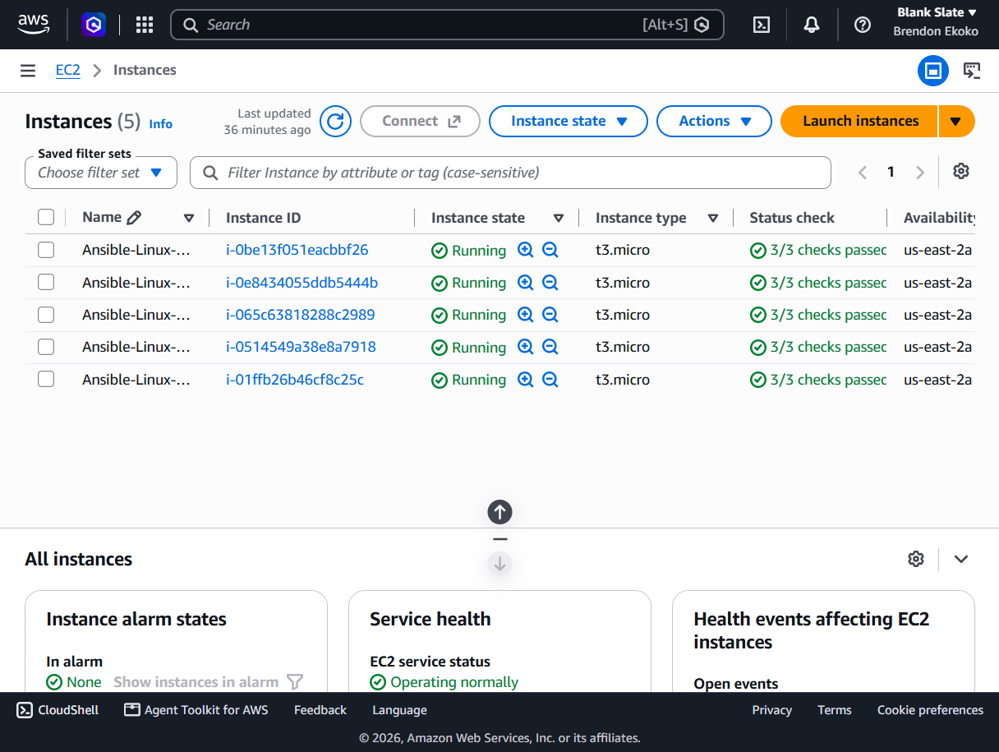
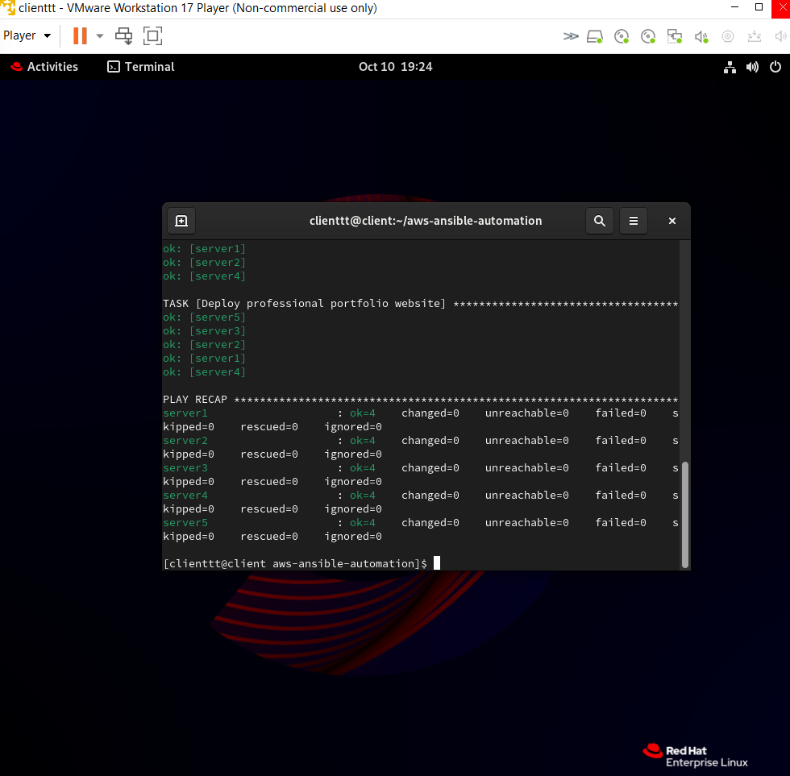
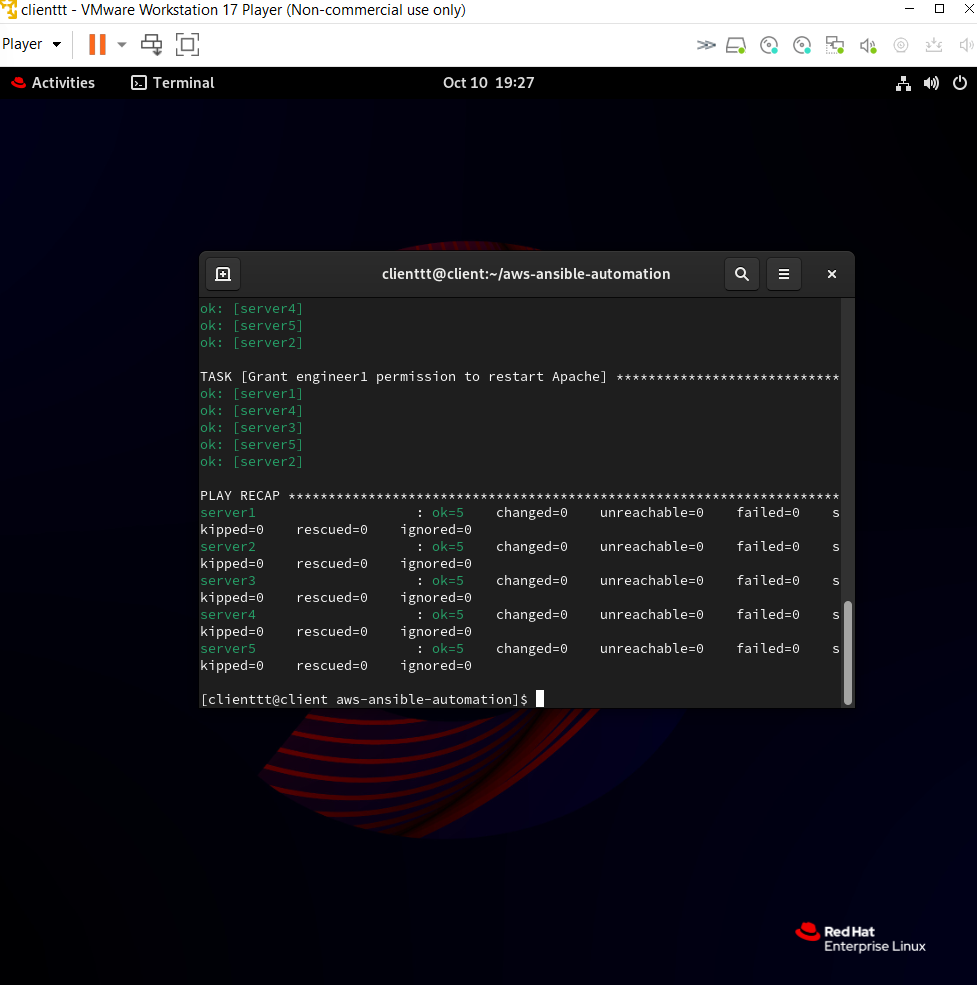
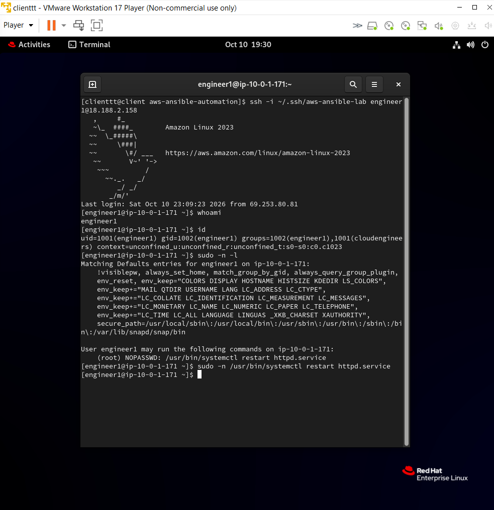
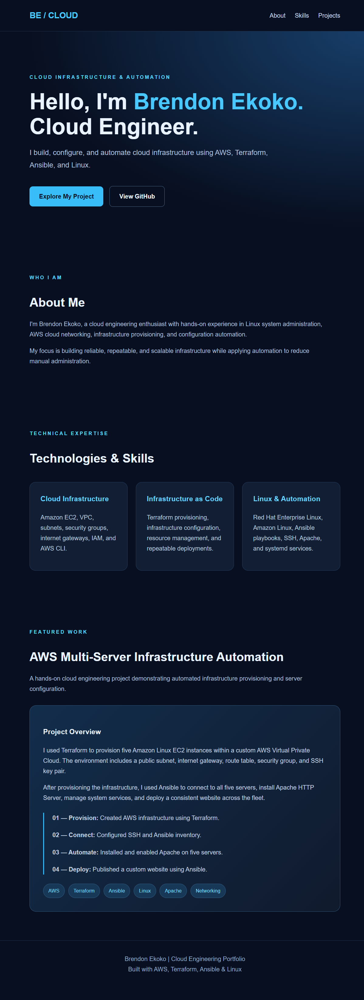

# AWS Multi-Server Infrastructure Automation
### Terraform | Ansible | AWS | Linux

## Project Overview

This project demonstrates how I used Terraform and Ansible to provision, configure, and manage a multi-server AWS cloud environment.

I deployed five Amazon Linux EC2 instances using Terraform and automated their configuration with Ansible.

The project includes Apache web server deployment, a professional portfolio website, Linux user provisioning, SSH authentication, and least-privilege access management.

## Technologies Used

- Amazon Web Services (AWS)
- Terraform
- Ansible
- Red Hat Enterprise Linux
- Amazon Linux
- Apache HTTP Server
- SSH
- HTML/CSS
- Git and GitHub

## AWS Infrastructure

Using Terraform, I provisioned:

- Five Amazon Linux EC2 instances
- Custom Virtual Private Cloud (VPC)
- Public subnet
- Internet Gateway
- Route table and association
- Security group
- SSH key pair

### EC2 Infrastructure

## Apache Web Server Automation

I developed an Ansible playbook that automatically:

1. Connects to five EC2 instances.
2. Installs Apache HTTP Server.
3. Starts and enables the Apache service.
4. Deploys a custom HTML/CSS website.

## Linux User Management

I used Ansible to automate Linux account provisioning across all five EC2 instances.

The automation created:

- Three Linux user accounts per server
- A shared `cloudengineers` group
- Home directories and group memberships

This resulted in 15 Linux accounts provisioned through one playbook.

## SSH Authentication and Security

I configured SSH public-key authentication for a test account using Ansible.

I also implemented restricted sudo permissions, allowing the account to restart Apache without granting unrestricted administrative access.

## Cloud Engineering Portfolio

I developed a responsive portfolio website using HTML and CSS.

The website highlights my cloud engineering skills, technologies, and AWS automation project.

Ansible deployed the website across all five EC2 instances.

## Project Architecture

My RHEL virtual machine served as the Terraform and Ansible control node.

Terraform provisioned the AWS infrastructure, while Ansible connected to the EC2 instances through SSH to automate server configuration.

The five EC2 instances hosted Apache and the same portfolio website.

## Key Skills Demonstrated

- Infrastructure as Code
- AWS cloud networking
- Multi-server Linux administration
- Ansible configuration management
- Automated application deployment
- Linux user and group management
- SSH public-key authentication
- Least-privilege access control
- Infrastructure troubleshooting

## Security Considerations

SSH access was restricted to the administrator's public IP address.

Private SSH keys, Terraform state files, and local inventory data are excluded from GitHub.

This project was created as a temporary lab environment rather than a production-hardened deployment.

## Author

**Brendon Ekoko**

Cloud Engineering | AWS | Terraform | Ansible | Linux

GitHub: https://github.com/brendonekoko
